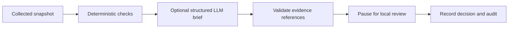

# AccessScope — AI-Assisted AWS Access Reviews

A local identity-governance prototype that turns scoped AWS configuration into evidence-backed access-review cases. Deterministic checks identify configured issues, an optional language model explains them, and a person records a review decision. No component can mutate AWS.

**Repository:** [Aditya250401/accesSope](https://github.com/Aditya250401/accesSope). The project is named **AccessScope**; `accesSope` is the repository slug.

## Learn the implementation

Start with the [guided repository walkthrough](WALKTHROUGH.md). It connects one example across the input, contracts, rules, graph state, model boundary, review and audit, with reading stops and questions to answer. The Python modules contain matching comments explaining the purpose of each stage.

After `uv sync --locked`, run `uv run python -m accessscope.walkthrough` to watch real node updates, pause/resume and a duplicate audit write. This learning command uses the fictional fixture and scripted explanation, makes no AWS/model calls, and removes its temporary audit database afterward.

## What it checks

| Check | Evidence used | Result |
| --- | --- | --- |
| Production ownership | Supplied owner and acceptance records | Missing accepted owner, satisfied, unknown, or not applicable |
| Access-review deadline | Recorded due date and snapshot date | Overdue, satisfied, or unknown |
| Wildcard-action grant | Collected role policy statements | A configured `Action: "*"` Allow, satisfied check, or unknown |

The included data is fictional. This is a prototype, not a complete IAM evaluator or a production IGA platform. A configured policy statement does not prove effective access.

## Run it

```bash
git clone https://github.com/Aditya250401/accesSope.git
cd accesSope
uv sync --locked
uv run python -m accessscope.cli --decision investigate
uv run pytest -q
```

Requires [uv](https://docs.astral.sh/uv/getting-started/installation/) and Python 3.12; `.python-version` selects the interpreter version. `uv.lock` fixes the dependency resolution.

Omit `--decision` to enter a choice when the graph pauses. The default runs real LangGraph nodes, validation, checkpointed review and SQLite audit with a **scripted explanation**, without AWS credentials or model API calls. An automatic choice still resumes a real interrupt; it is not an autonomous access approval.

Open `outputs/latest/review.json`. It contains rule outcomes, the explanation, exact evidence references, snapshot fingerprint and the recorded decision. `reviews.db` persists the decision; the graph's in-memory checkpoint does not survive a process restart.

Each new invocation starts a new review case. Pass `--case-id my-review` to retry a particular case: the same decision is idempotent, while a conflicting decision for the same case and snapshot is rejected. Reusing a case ID does not recover an in-memory graph checkpoint after process restart.

## The problem and the complete flow

The fictional support workload and billing workload use one role. Its policy contains `Action: "*"`. The support workload lacks an accepted owner and has an overdue review. The billing workload has an accepted owner and a future review deadline.

The default run produces four findings and two satisfied checks, then records the chosen review decision. These are expected results for the supplied fixture, not measured model accuracy.



1. `models.py` validates the input and rejects duplicate identifiers and cross-account role records.
2. `rules.py` checks accepted production ownership, recorded review deadlines, and wildcard-action Allow statements. Each outcome is `finding`, `satisfied`, `unknown`, or `not_applicable`.
3. `workflow.py` builds one review case. The explanation receives findings, source evidence, coverage limits and the selected workloads sharing a role. It cannot change rule outcomes.
4. The validator checks that finding/evidence IDs exist and active findings are covered. **That does not prove the generated prose is true.** A human must review the meaning.
5. LangGraph pauses at `review`. Resumption must include the exact snapshot fingerprint. Model work is in an earlier node, so resuming this review does not repeat it.
6. The local decision is `retain`, `investigate`, or `propose_change`. SQLite deduplicates an identical decision and rejects a conflicting decision for the same case/snapshot. There is no AWS action executor.

The local reviewer name is operator-entered, not authenticated enterprise identity. A hosted version needs authenticated reviewer permissions, tenant boundaries and persistent graph checkpoints before claiming those properties.

## Optional real model

Export `OPENAI_API_KEY` and `OPENAI_MODEL` locally, then run:

```bash
uv sync --locked --extra live
uv run --extra live python -m accessscope.cli --live-model
```

Choose a structured-output model available to your account. This explicitly sends the selected evidence to that API and may incur charges. The adapter uses one Responses API call, a Pydantic output schema, a 30-second timeout, no automatic retries, a 1,500-output-token cap and `store=False`. This flag is not a universal data-retention guarantee. Refusals, incomplete outputs and API errors stop before review. No live model call was used to establish the offline test result.

Only policies belonging to selected workload roles enter the explanation evidence catalog. Inputs larger than 24,000 serialized characters are rejected before the model call, rather than silently truncating evidence or spending without a bound. This is a character limit, not an exact token estimate.

## Optional AWS collection

Edit `fixtures/contexts.example.json` with exact Lambda ARNs in one account/region and operator-supplied business context. `complete` is a declaration about the supplied business-context scope, not a claim about AWS-wide collection. Workload names/tags alone do not establish accepted ownership.

```bash
uv run --extra live python -m accessscope.cli --collect-aws \
  --region us-east-1 --contexts fixtures/contexts.example.json
```

The adapter uses boto3's usual credential/profile chain. Its only AWS operations are STS `GetCallerIdentity`, IAM `GetAccountAuthorizationDetails`, and Lambda `ListFunctions`. Paginators consume later pages. Managed-policy default versions are resolved against collected attachments. Unresolved policy documents mark policy coverage incomplete. A denied scan, or a selected workload not observed, produces explicit collection limitations.

IAM is account-scoped; Lambda collection here is limited to one specified region and selected ARNs. Shared-consumer context includes **only selected workloads**, not every possible consumer of a role. Other regions, other workload types, resource policies, SCPs, boundaries, sessions and business ownership systems are not fully collected or evaluated. Real AWS credentials and live account behavior have not been verified by the offline suite.

## Why the conclusions are deliberately narrow

- `Action: "*"` in an Allow statement is a configuration finding. Conditions, denies and other controls can restrict it. It is not proof of effective administrator access.
- A satisfied wildcard check means that exact pattern was not found in supported collected statements; it does not establish least privilege.
- Missing or unsupported evidence gives `unknown`, rather than a fabricated clean result.
- A shared role is a dependency to investigate, not automatically a vulnerability.
- The model explains evidence; it does not determine AWS authorization or infer safe revocation from inactivity.

This is an LLM-assisted workflow with fixed graph edges, not a fleet of autonomous agents. Add dynamic tools or additional roles only for a demonstrated investigation need. The deterministic checks remain usable without a model.

## Evaluation and interview experiments

The offline suite blocks network connections and exercises real graph pause/resume, later-page collection, partial scans, unsupported policy constructs, invented model references, stale decisions and audit conflicts. Fake clients test the model adapter's call boundary, not model quality.

Try these changes and predict the result:

1. Set `iam_complete` to false: wildcard findings become unknown, while business-context checks keep their own evidence rules.
2. Add a condition to the wildcard statement: the configuration finding remains narrow; its prose must not claim effective access.
3. Change an owner after producing a case: its snapshot fingerprint changes, and an old review cannot approve that new snapshot.
4. Return an invented evidence ID from the explainer: validation stops before review.
5. Resume a paused review: observe that the explanation is not generated again.

For real model evaluation, create a separate human-labelled set, check factual support and useful reviewer questions, and compare against the deterministic baseline. The offline checks do not establish model accuracy, reviewer time savings or production security.

## Read the code in this order

| File | Responsibility |
| --- | --- |
| [`fixtures/demo.json`](fixtures/demo.json) | Fictional workloads, role policy and business context |
| [`accessscope/models.py`](accessscope/models.py) | Snapshot, finding, explanation and decision contracts |
| [`accessscope/rules.py`](accessscope/rules.py) | Deterministic checks and the selected evidence catalog |
| [`accessscope/workflow.py`](accessscope/workflow.py) | Explanation, reference validation, review interrupt and audit |
| [`accessscope/cli.py`](accessscope/cli.py) | Explicit demo/live choices and report export |
| [`accessscope/collect.py`](accessscope/collect.py) | Paginated, read-only AWS collection |
| [`tests/test_review.py`](tests/test_review.py) | Offline regression and integration-boundary cases |

## Verification status and next steps

- **Verified locally:** the fixture-driven workflow, real graph pause/resume, evidence checks, audit conflict handling and offline regression suite.
- **Implemented but not exercised against live services:** the AWS collection and OpenAI explanation adapters.
- **Future work:** authenticated reviewers, durable graph checkpoints, human-labelled model-quality evaluation and a separately authorized remediation workflow.

No customer adoption, production deployment, real-model accuracy or automatic permission remediation is claimed.

## Primary references

- [IAM account authorization inventory](https://docs.aws.amazon.com/IAM/latest/APIReference/API_GetAccountAuthorizationDetails.html)
- [AWS policy evaluation](https://docs.aws.amazon.com/IAM/latest/UserGuide/reference_policies_evaluation-logic.html)
- [LangGraph interrupts](https://docs.langchain.com/oss/python/langgraph/interrupts)
- [OpenAI structured outputs](https://developers.openai.com/api/docs/guides/structured-outputs)
