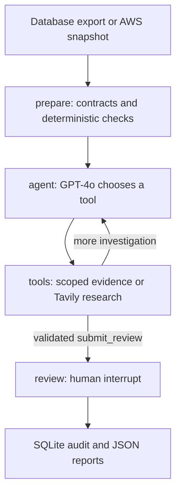

# AccessScope - AI access-review investigator

AccessScope runs a real GPT-4o tool-calling agent over a scoped AWS access snapshot. Deterministic code derives configuration/governance outcomes. The model chooses evidence lookups, inspects shared consumers, researches AWS documentation through Tavily and submits a structured brief. LangGraph coordinates the loop and human-review pause; SQLite records completed decisions.

The project is named **AccessScope**; its repository slug is [`accesSope`](https://github.com/Aditya250401/accesSope).

## Start the real agent

```bash
git clone https://github.com/Aditya250401/accesSope.git
cd accesSope
uv sync --locked
cp .env.example .env
```

Set your own OpenAI/Tavily credentials and `CHAT_MODEL=gpt-4o` in `.env`. Configure LangSmith only if you want the selected evidence and run traces sent there. Exported variables take precedence. `.env` is ignored by Git.

```bash
uv run python -m accessscope.cli --snapshot private/authsec-snapshot.json
```

The default input is `private/authsec-snapshot.json`, deliberately absent from public Git. Missing input or credentials stops execution; the application never silently substitutes scripted output. Tool choices appear as it runs. It then prompts for `retain`, `investigate` or `propose_change`. Add `--decision investigate` for a non-interactive investigation decision; no choice applies a cloud change.

## The agent loop



| Tool | Capability |
| --- | --- |
| `get_review_findings` | Read outcomes, coverage and selected workload-role bindings |
| `get_evidence` | Read an exact evidence ID belonging to this snapshot |
| `get_role_evidence` | Read a selected role's collected policy evidence in one bounded lookup |
| `get_shared_consumers` | Read known selected consumers of an in-scope role |
| `search_aws_docs` | Tavily research using fixed public queries restricted to AWS documentation |
| `submit_review` | Submit a brief citing observed evidence and returned research sources |

The model chooses order/arguments; Python enforces capabilities. Limits: ten model turns, two documentation searches, a 30-second model timeout, no SDK retries, 1,600 output tokens per request, and character budgets for conversation/tool results. Human-review resumption does not repeat the investigation.

Tavily receives fixed generic queries, not account IDs, policy documents or customer-generated search strings. Web snippets are untrusted guidance, not facts about the reviewed account.

## Real data without inventing certainty

The checks cover accepted production ownership, recorded review deadlines and the exact configured `Action: "*"` Allow pattern. Outcomes are `finding`, `satisfied`, `unknown` and `not_applicable`. These are configuration/governance checks, not complete effective-permission analysis.

The local importer converts a selected database export before it reaches the model:

```bash
uv run python -m accessscope.import_iga --bundle private/db-case-private.json
```

It pseudonymizes account/role/workload/user IDs and redacts policy resource/condition strings before fingerprinting. The provenance manifest records the source scan and export times. Missing business-purpose/owner-acceptance coverage remains unknown. A database export is not a fresh AWS scan; redacted policy documents must never be deployed.

Keep raw export, pseudonym salt, snapshot and provenance under ignored `private/`. Public Git contains no employer dataset or database connection. Obtain authorization before sending employer-derived evidence to model or tracing providers, including redacted evidence.

The validator checks references and finding coverage. The agent also requires cited evidence to have been read and research IDs to belong to returned sources. This does not prove every generated sentence is true; human review and labelled semantic evaluation are separate needs.

No tool can change AWS or the source database. Reviewer names are operator-entered attribution, not authenticated enterprise identity. Checkpoints remain in memory; completed audit rows persist in SQLite. Durable workflow recovery and hosted reviewer authorization remain future work.

## Reports and tracing

- `outputs/latest/snapshot.json`: selected input and coverage.
- `outputs/latest/investigation.json`: model/tool log, research sources, token usage and brief, saved before prompting.
- `outputs/latest/review.json`: completed case, fingerprint and decision.
- `outputs/latest/reviews.db`: completed local review records.

`LANGSMITH_TRACING=true` sends graph/model traces, including selected evidence/tool results, to the configured LangSmith project/endpoint. Credentials never enter graph state. The report records the root trace run ID.

New invocations get fresh case IDs. An identical audit retry for one case/snapshot is idempotent; conflicting choices are rejected. `--case-id` does not recover an in-memory checkpoint after restart.

## Later: read AWS directly

```bash
uv sync --locked --extra live
uv run python -m accessscope.cli --collect-aws --profile YOUR_PROFILE \
  --region us-east-1 --contexts private/contexts.json
```

Collection uses STS `GetCallerIdentity`, paginated IAM `GetAccountAuthorizationDetails` and paginated Lambda `ListFunctions`. Exact Lambda ARNs select scope. IAM is account-scoped; Lambda is limited to the chosen region. Denied/missing evidence remains a coverage limitation.

## Learn and verify

Start with [WALKTHROUGH.md](WALKTHROUGH.md) for the real agent. The original fixed-graph lesson is explicitly offline:

```bash
uv run python -m accessscope.cli --demo --decision investigate
uv run python -m accessscope.walkthrough
uv run pytest -q
```

Demo/learning commands use scripted text and fictional input. Tests use fake provider boundaries and block network connections. They check mechanics, not live model quality or live AWS collection.

## Primary references

[OpenAI function calling](https://developers.openai.com/api/docs/guides/function-calling), [Tavily Search](https://docs.tavily.com/documentation/api-reference/endpoint/search), [LangGraph interrupts](https://docs.langchain.com/oss/python/langgraph/interrupts), [LangSmith tracing](https://docs.langchain.com/langsmith/trace-with-langgraph), [AWS policy evaluation](https://docs.aws.amazon.com/IAM/latest/UserGuide/reference_policies_evaluation-logic.html).
