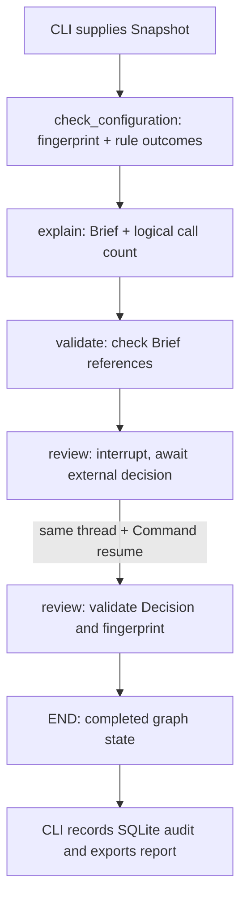

# Understand and defend AccessScope

Keep this page on one side and the named file on the other. Each stop starts with a need, follows the actual code, and ends with a question you should answer before continuing. Read the core once with the fixture. Study the AWS/model adapters afterward.

You do not need to memorize Python syntax. You should be able to say what enters a step, what it produces, why the next step needs it, and what would make the result unreliable.

## Start with the actual problem

A reviewer is looking at two programs: Support and Billing. Both use the same AWS role. The role has a configured wildcard-action Allow statement. Support also lacks an accepted owner and has an overdue review.

The reviewer needs to understand the evidence and decide what to investigate. A paragraph generated from a role name is insufficient. We need collected facts, explicit checks, source references, an explanation, a review choice and a record of that choice. Those needs create the files below.

AccessScope implements an **LLM-assisted access-review workflow**. Its graph has fixed edges. It does not autonomously choose tools, calculate complete effective AWS permissions, or change permissions. The default demo uses fictional data and scripted text; the real graph still runs and pauses.

### Run before reading

From the repository folder:

```bash
uv sync --locked
uv run python -m accessscope.walkthrough
```

This learning command shows actual node updates, the paused state, resumption and a duplicate audit write. It uses no AWS/model services. Its audit database is temporary. Read the runner's code last; it is an observer of the project, not another implementation of the rules.

For the normal application and persistent output:

```bash
uv run python -m accessscope.cli --decision investigate
```

Open `outputs/latest/snapshot.json` and `outputs/latest/review.json`. The first contains input/coverage; the second contains results and the decision. `outputs/latest/reviews.db` retains completed review records. A new default CLI invocation starts a new case and overwrites the two latest JSON exports.

## The reading route

| Stop | Open this | Understand this before moving on |
| --- | --- | --- |
| 1 | [fixtures/demo.json](fixtures/demo.json) | Which program uses which role, and which facts are supplied? |
| 2 | [accessscope/models.py](accessscope/models.py) | Snapshot -> Finding -> Brief -> Decision are different records |
| 3 | [accessscope/rules.py](accessscope/rules.py) | Three checks per workload, with uncertainty preserved |
| 4 | [accessscope/workflow.py](accessscope/workflow.py): `State`, `explanation_input`, explainers, `validate_brief` | What is passed to the explainer and what its validator proves |
| 5 | Same file: `build_graph` | State updates, node registration, fixed edges, compile and pause/resume |
| 6 | Same file: `record_decision` | Why a completed review needs its own durable audit write |
| 7 | [accessscope/cli.py](accessscope/cli.py) | How loading, two graph invocations, auditing and exporting connect |
| 8 | [accessscope/collect.py](accessscope/collect.py) and [contexts.example.json](fixtures/contexts.example.json) | How live configuration can replace the fixture |
| 9 | [tests/test_review.py](tests/test_review.py) | How the design is challenged at its boundaries |
| 10 | [pyproject.toml](pyproject.toml), `.python-version`, `.env.example`, `.gitignore`, `uv.lock`, `__init__.py` | Setup, optional dependencies and generated/local files |
| Last | [accessscope/walkthrough.py](accessscope/walkthrough.py) | How the learning command observes the same graph |

Reading order starts with the facts. Runtime starts in `cli.main()`. These are different questions: learn what the data means first, then trace who calls whom.

## 1. Follow one role through the input

Open `fixtures/demo.json`. Read `workloads` before `roles`.

```text
support-demo ----+
                +---- role/shared-demo ---- policy:shared-demo:v1
billing-demo ---+
```

Each workload's `role_arn` points to the role's `arn`. That is the join between the program and its access configuration. `document.Statement[0]` contains `Effect: Allow`, `Action: "*"` and `Resource: "*"`.

The fixture also supplies business context. `owner` names a team/person; `owner_accepted` records acceptance; `review_due` is a recorded deadline. The application cannot establish accepted business ownership just from an AWS role name.

Two dates have different jobs. `collected_at` says when this evidence was collected. `as_of` is the date against which the review deadline is evaluated. The fixture fixes both on 25 October 2026. Running it on 26 October does not silently change the exercise.

Coverage is part of the evidence. `iam_complete` concerns the IAM inventory, `workload_scan_complete` the selected workload scan, `context_complete` the supplied business context, and each role has `policy_coverage_complete` for its attached documents. These flags are inputs, not independent proof that an import was trustworthy.

**Pause and answer:** Why must we retain both workload-to-role bindings? Because changing that shared role could affect both selected consumers. We have not established that these are its only consumers anywhere in AWS.

## 2. Why four record types exist

Open `models.py` and read its classes in order.

| Record | Contains | Created by | Used by |
| --- | --- | --- | --- |
| `Snapshot` | Scope, times, coverage, roles/policies, workloads/context | Fixture parser or collector | Rules, evidence selection and fingerprinting |
| `Finding` | One check's outcome, explanation and evidence IDs | `evaluate` | Explainer, validator and reviewer |
| `Brief` | Summary, finding IDs, evidence IDs, reviewer questions | Scripted or live explainer | Validator and reviewer |
| `Decision` | Action, reviewer text, reason, snapshot fingerprint | Validated resume input | Audit and exported report |

There is a reason these are separate. A model's explanation should not overwrite the facts from which the findings were derived. A review choice should not overwrite the explanation and pretend it was evidence.

### Pydantic's job in this code

`Contract` inherits from Pydantic's `BaseModel`. Its subclasses inherit field parsing/checking. `extra="forbid"` rejects an unrecognized field rather than ignoring a typo.

`Snapshot.model_validate_json(text)` reads JSON and builds a checked `Snapshot`; dates become date/datetime values. `Snapshot.model_validate(data)` accepts data such as a Python dictionary. Checking field shape does not establish the authenticity of the source.

The `unique_references` validator runs after fields are built. It rejects duplicate role/workload/evidence IDs, unsupported account-role scope and policy IDs that collide with the reserved `context:` namespace. A missing role binding is handled later as an unknown access check; this contract does not claim to validate every possible relationship.

### Three conversions you will see

| Expression | Result | Need |
| --- | --- | --- |
| `model_dump()` | Python dictionary | Manipulate record fields in ordinary code |
| `model_dump(mode="json")` | Dictionary with JSON-compatible values | Put dates/records into an API payload or JSON export |
| `model_dump_json()` | JSON text | Write a complete record to a file |

### The fingerprint's job

`fingerprint()` serializes the complete snapshot with sorted keys and hashes it. A changed owner, date, policy or coverage field changes the contents being hashed. The review can therefore name the exact snapshot it belongs to.

It does not authenticate AWS, encrypt the evidence or compare against fresh AWS state. Because timestamps are included, a newly collected but otherwise equivalent snapshot can have a different fingerprint. This is not automatically an effective explanation-cache key.

**Pause and answer:** Is `Brief` evidence? It is an explanation of evidence. Its fields can be well formed while its summary is false.

## 3. Derive all six outcomes before involving a model

Open `rules.py`, starting at `evaluate`.

`roles = {r.arn: r ...}` creates a lookup from role ARN to role record. For each workload, the function checks its context and looks up its role. The small inner `emit` helper creates an outcome record with a stable ID such as `support-demo:owner`.

The class name `Finding` can be misleading: every check produces one, including a satisfied or unknown check. Always look at `outcome`.

### Owner check

The order of conditions matters. Incomplete context -> unknown. Confirmed non-production -> not applicable to this particular owner rule. Confirmed production with owner plus acceptance -> satisfied. Otherwise -> finding.

A missing accepted owner in a declared complete context is different from an incomplete import that may have omitted an owner. The latter should not become an invented negative fact.

### Deadline check

Incomplete context or no deadline -> unknown. A date strictly before `as_of` -> finding. Otherwise -> satisfied. A deadline equal to `as_of` is not overdue under this implemented rule.

### Wildcard-action check

Incomplete IAM inventory, a missing role record, or incomplete attached-policy coverage -> unknown. Otherwise inspect collected statements, normalizing a single statement object into a list and a single action string into a list.

The specific pattern is an Allow with exact action `"*"`. `"s3:*"` is not the same literal pattern and is not detected by this rule. `NotAction` and certain malformed shapes are unsupported. If an exact wildcard is observed, report that pattern; if none is observed but unsupported statements remain, return unknown. Otherwise the narrow check is satisfied.

This is not a complete IAM syntax validator. For example, it does not prove the validity of all resources/conditions, calculate effective permissions or establish least privilege. An empty supported statement list can satisfy the narrow pattern search. Preserve that scope when discussing the project.

### Predict the fixture's result

| Outcome ID | Why | Outcome | Evidence ID |
| --- | --- | --- | --- |
| `support-demo:owner` | Production without accepted owner | finding | `context:support-demo` |
| `support-demo:review_due` | 1 October is before 25 October | finding | `context:support-demo` |
| `support-demo:wildcard_action` | Role has configured wildcard Allow | finding | `policy:shared-demo:v1` |
| `billing-demo:owner` | Owner exists and accepted | satisfied | `context:billing-demo` |
| `billing-demo:review_due` | 1 November is after 25 October | satisfied | `context:billing-demo` |
| `billing-demo:wildcard_action` | Same role's configured wildcard Allow | finding | `policy:shared-demo:v1` |

That is **six outcome records, four active findings, two satisfied checks**. Two wildcard outcomes point to one shared policy; they do not establish two distinct broad policies.

### Two helpers connect the rules to the explanation

`evidence_catalog` builds an ID-to-source mapping: collected policy documents for selected workload roles, plus supplied context records. A citation is useful only if the reviewer can follow it back to actual input. The collector may hold many roles; the explanation does not need unrelated role policies.

`shared_role_consumers` groups selected workloads by role ARN and returns groups with multiple consumers. This gives the explainer/reviewer shared-impact context without claiming a complete AWS dependency inventory.

**Pause and answer:** If IAM collection fails, should the owner rule also become unknown? Not solely for that reason. It depends on business-context evidence. The wildcard check depends on IAM evidence.

## 4. Explain existing findings, then check the explanation

Open `workflow.py`, before `build_graph`.

### State is the working data, not another input database

`State(TypedDict, total=False)` names the fields carried between graph nodes. A run begins with only `snapshot`. Later stages add `fingerprint`, `findings`, `brief`, `model_calls` and eventually `decision`.

`TypedDict` is a shape hint. It is not the Pydantic validation boundary, a database or an automatically growing conversation. This workflow does not need `MessagesState`: it passes records through a fixed review process rather than maintaining a chat/tool-call history.

### Build the explainer's packet

`explanation_input(snapshot, findings)` combines scope, limitations, all check outcomes, the evidence catalog and known selected shared consumers. The model should be able to connect an outcome to the source that produced it. It cannot change the rule results by returning different prose.

### Two interchangeable explainers

`DemoExplainer` and `OpenAIExplainer` both expose `.explain(payload) -> Brief`. The graph can use either without changing the rule implementation. The demo returns scripted text and references; `.live` is false.

The optional live adapter serializes the packet, rejects inputs above 24,000 characters and makes one structured-output request. The normal client uses a 30-second timeout and no automatic retries; output is capped at 1,500 tokens. Input characters and output tokens are different units. An unusable parsed output or API error stops execution before review.

The `model_calls` field counts a logical live-explainer invocation here. It is not a measurement of token cost or provider billing. No live-model-quality result follows from running the scripted demo.

### What `validate_brief` actually checks

It parses the `Brief`, requires a non-empty summary, rejects unknown finding/evidence IDs, requires every active finding's ID and checks that cited evidence overlaps that finding's evidence list.

Example: `support-demo:owner` exists; `context:support-demo` supports its rule result. `context:invented-owner` does not exist and must be rejected.

A summary saying "all permissions are safe" could still cite real IDs and pass these mechanical checks. The validator does not prove that every sentence follows from the evidence. Human review and a separate labelled semantic evaluation address a different question.

**Pause and answer:** Why not ask the model to produce the rule outcomes too? The implemented checks are explicit, reproducible and usable without a model. An explanation is a separate output whose quality can be evaluated independently.

## 5. Build the graph in your head

Continue into `build_graph` in `workflow.py`.

### First define operations; nothing has run yet

`explainer = explainer or DemoExplainer()` selects a dependency. The inner node functions can use that selected explainer because they are defined within the same function scope. Defining a function does not execute it.

`StateGraph(State)` creates the builder. `add_node` associates a name with a function. `add_edge` defines which operation follows another. `compile(checkpointer=...)` produces the executable graph; it does not run the fixture or call an API.

The registration loop contains `(name, function)` pairs. Passing `check_configuration` supplies the function to be called later. Passing `check_configuration(...)` would call it immediately, which is not what registration needs.



There is one registered `review` node; the two review boxes show its first execution and resumption. SQLite auditing is outside the graph in this implementation.

### Follow the state updates

| Moment | Update returned | What remains available |
| --- | --- | --- |
| Initial invocation | Caller supplies `snapshot` | Input snapshot |
| `check_configuration` | `snapshot`, `fingerprint`, `findings`, `model_calls=0` | Rule evidence and results |
| `explain` | `brief`, `model_calls` | Snapshot/results plus the explanation |
| `validate` | Validated `brief` | Prior facts remain |
| First `review` execution | Interrupt; no `decision` update yet | State checkpoint and review payload |
| Resumed `review` | `decision` | Completed case state |

No custom reducers are defined. Returning `{"brief": brief}` replaces the brief field and preserves fields omitted from that update. Returning a list for `findings` does not automatically append to an old list. Fixed edges provide the sequence; the model is not deciding the route.

If there are no active findings, `explain` produces a local brief without a model call. All-unknown outcomes are possible, so the text still points to unknowns/coverage gaps. Inspect the snapshot's coverage/errors alongside the report.

### The pause needs three pieces

1. `interrupt(payload)` marks where external input is required.
2. A checkpointer retains the execution state.
3. `configurable.thread_id` identifies which execution to resume.

The first `invoke` runs through validation and pauses in `review`. It returns state plus `__interrupt__`; no completed `Decision` exists.

The second `invoke(Command(resume=decision_input), same_config)` resumes that thread. The interrupted node restarts; its `interrupt()` returns the supplied resume data. The code then validates the `Decision` and compares its fingerprint with the stored case.

This is why paid model work lives in the preceding node. It is not repeated merely because the review node resumes. Do not place an unguarded paid call or irreversible side effect before `interrupt()` inside that node.

`InMemorySaver` keeps checkpoints in this process. Its serializer is configured to reconstruct only the named local Pydantic contract classes. This supports this local state representation; it is not a durable store or general trust boundary for uploaded checkpoints.

**Pause and answer:** Would a fresh graph with a fresh saver find this paused execution just because you reused its thread ID? No. You also need the saved execution state; the current in-memory saver does not survive a process restart.

## 6. Why the graph checkpoint is not the audit

Read `record_decision` at the bottom of `workflow.py`.

The checkpointer remembers where execution paused. The audit remembers a completed choice. Different jobs require separate persistence.

`record_decision` checks the decision's shape/fingerprint and serializes it. The SQLite primary key is `(case_id, fingerprint)`. Inserting exactly the same decision for that pair again leaves one row. A different action, reviewer or reason for that same pair is rejected after comparing the stored payload.

This is application-level idempotency for one audit operation. It does not implement exactly-once cloud changes; no cloud write exists. A different case ID can record a separate review of the same snapshot.

The reviewer string comes from CLI input, not authenticated enterprise identity. A stored fingerprint binds the choice to stored evidence, not to a fresh AWS read. These are important hosted-version improvements, not current properties.

**Pause and answer:** After a process restart, what survives? The SQLite file's completed rows. An unfinished in-memory graph checkpoint does not.

## 7. Now connect the whole runtime in `cli.py`

Read `main()` from top to bottom. You now know what each called operation is for.

```text
parse arguments
  -> fixture OR AWS collector -> Snapshot
  -> save snapshot.json
  -> choose scripted OR real explainer
  -> build graph; choose case_id/thread_id
  -> invoke with snapshot -> pause
  -> obtain review choice
  -> invoke with Command(resume=...) -> finish
  -> record_decision -> reviews.db
  -> export review.json
```

The two mode flags are independent:

| `--collect-aws` | `--live-model` | Evidence | Explanation |
| --- | --- | --- | --- |
| Absent | Absent | Fictional fixture | Scripted |
| Present | Absent | Scoped AWS reads + supplied context | Scripted |
| Absent | Present | Fixture or specified snapshot | Real API call |
| Present | Present | Scoped AWS reads + supplied context | Real API call |

Only the default needs to be run for this walkthrough. An input `--snapshot` file is used in the non-collection path. `--collect-aws` requires the separate `--contexts` and `--region` inputs.

`input()` is the CLI waiting for a typed choice. `interrupt()` is the graph pause. `--decision investigate` bypasses typing the choice, not the graph pause or decision validation.

A fresh UUID is the default case/thread ID. `--case-id` allows deliberate audit retries; it does not turn process-local checkpoints into restart recovery. Review names/reasons are part of the stored payload, so changing them on the same case/snapshot is a conflicting decision.

### Inspect the output and explain it aloud

In `review.json`, locate `mode`, `model_calls`, `findings`, `brief`, `decision` and `snapshot_fingerprint`. For the default run, expect `scripted_demo`, zero model calls and decision `investigate`. Count outcome records separately from active findings.

Use this explanation: "I load and validate a snapshot, derive explicit outcomes, explain only the selected evidence, check the references, pause for review, validate the returned decision and record it. The audit and graph checkpoint have different lifetimes. No step changes AWS."

## 8. Replace the input without changing the core

Open `collect.py`. The CLI first gets the account ID using STS. The collector receives IAM/Lambda clients rather than constructing hidden credentials inside the rules.

`GetAccountAuthorizationDetails` is paginated. Role details and managed-policy documents may arrive on different pages, so the function first gathers pages and builds the managed-policy index. It then joins inline policies and attached managed policies to each role, using the collected default managed-policy version.

Unresolved attachments mark role coverage incomplete. IAM collection failure preserves collected pages but marks the overall IAM inventory partial. It does not produce a clean scan.

`ListFunctions` is paginated for one region. Exact Lambda ARNs in the supplied contexts select which functions become reviewed workloads. A selected ARN that is not observed marks workload coverage incomplete; the collector does not invent a deleted function or create a substitute workload record.

`contexts.example.json` demonstrates the separate business inputs. `complete: false` means context coverage has not been declared complete. It is not an AWS response. The default fixture uses short teaching workload IDs; live collection uses exact selected Lambda ARNs as workload IDs.

The collector returns the same `Snapshot` contract used by the fixture. That is the architectural connection: adapters translate external input into a contract; the rules and graph operate on that contract.

**Pause and answer:** Why can't this prove effective administrator access? It searches a configured policy pattern without fully collecting/evaluating all applicable policies and request context. IAM inventory, ownership governance and request authorization are related but different problems.

## 9. Read the tests as questions about the design

Run the existing suite:

```bash
uv run pytest -q
```

It collects 29 cases because parametrized functions run with multiple inputs. The network-blocking fixture is automatic. AWS/model clients are fakes where needed; these tests do not establish live-service success or model accuracy.

| Question | Find this test |
| --- | --- |
| Can an unavailable source accidentally become a clean result? | `test_missing_coverage_cannot_become_satisfied` |
| Can an unsupported statement silently pass? | `test_unsupported_policy_shapes_are_unknown` |
| Does a condition get confused with unconditional effective access? | `test_configured_wildcard_does_not_claim_effective_access` |
| Can ambiguous evidence IDs enter the snapshot? | `test_ambiguous_or_cross_scope_records_rejected` |
| Are both selected consumers retained? | `test_shared_role_keeps_both_consumers` |
| Does resuming review repeat the model work? | `test_graph_pauses_and_resume_does_not_repeat_model_work` |
| Does a wrong snapshot/decision fail? | `test_stale_or_invalid_review_cannot_complete` |
| Does invented/omitted reference data fail? | `test_model_reference_errors_are_rejected` |
| Can a duplicate decision create a second row? | `test_audit_is_idempotent_and_conflicting_decision_rejected` |
| Are later pages and missing targets considered? | `test_collection_visits_later_pages_and_tracks_missing_targets` |
| Are request bounds/schema actually passed to the adapter? | `test_live_adapter_uses_schema_no_storage_and_bounded_single_request` |
| Are two CLI runs distinct cases? | `test_cli_repeated_demo_runs_start_separate_cases` |
| Can irrelevant role policies leak into the packet? | `test_unselected_role_policies_are_not_sent_to_model` |
| Is oversized input rejected before an API call? | `test_oversized_input_stops_before_a_model_call` |

`Spy` wraps the scripted explainer with a counter. Its `live=True` exercises the graph's count; it is not a real model. `Pages` and `SDK` provide only the SDK methods needed for collection tests. The shape of a fake makes the component boundary visible.

## 10. Understand the remaining repository files

`pyproject.toml` declares the project, Python range and dependency groups. LangGraph and Pydantic are core. boto3 and the model SDK are optional `live` extras. pytest is a development dependency. These choices make default study possible without credentials.

`uv.lock` records the resolved dependency graph. Read its purpose, not hundreds of generated package lines; update it with uv when dependencies change. `.python-version` selects Python 3.12 for this project.

`.env.example` lists optional configuration names. The program reads exported environment variables; it does not automatically load an `.env` file. boto3 follows its credential chain. Do not put real keys into the example.

`.gitignore` keeps environments, caches, credentials, generated outputs and database files out of Git. `__init__.py` marks the package without starting work on import. The top-level README is the public overview; this page is the learning route.

Finally open `walkthrough.py`: it uses `stream(..., stream_mode="updates")` to observe node updates and `get_state()` to inspect the checkpoint. Those are alternative observation/execution interfaces for the same compiled graph used by the CLI's `invoke`. Its two identical audit calls demonstrate one retained row in a temporary database.

## Connect the identifiers without mixing them up

| Identifier | Example | Connects |
| --- | --- | --- |
| Workload ID | `support-demo` | Selected program to its check outcomes/context |
| Role ARN | `...:role/shared-demo` | Workload to collected IAM role |
| Evidence ID | `policy:shared-demo:v1` | Finding/brief citation to source record |
| Outcome ID | `support-demo:wildcard_action` | One workload/check result to its explanation |
| Case ID | Generated UUID | One review case and its audit row |
| Thread ID | Same UUID in this CLI | Execution to its saved checkpoint |
| Snapshot fingerprint | SHA-256 text | Review decision to exact stored input contents |
| Reviewer text | `local-demo-reviewer` | Local attribution supplied by the operator |

None of these is automatically an authenticated reviewer credential.

## Make five changes in a temporary copy and predict the result

Use a copy of `fixtures/demo.json`, leaving the original reference intact. After editing that copy, run:

```bash
uv run python -m accessscope.cli --snapshot /path/to/your-copy.json --decision investigate
```

1. **Set Support's owner and acceptance.** Its owner result becomes satisfied. Its overdue/wildcard findings remain. Total active findings: three.
2. **Start from the original and set `context_complete` false.** Four context-dependent outcomes become unknown. Both wildcard findings remain because IAM evidence is complete.
3. **Start from the original and set `iam_complete` false.** Both wildcard outcomes become unknown. Support's missing-owner and overdue findings remain.
4. **Start from the original and replace `Action: "*"` with `Action: "s3:GetObject"`.** Both narrow wildcard checks become satisfied. This does not prove least privilege or safe effective access.
5. **Start from the original and supply only unsupported `NotAction`.** Both wildcard outcomes become unknown. Explain why the checker stops short of guessing what the construct authorizes.

Then read the pause/resume test and the reference-rejection test. Predict their assertions before running them:

```bash
uv run pytest -q tests/test_review.py -k 'resume or reference'
```

## Defend the choices, then propose the next improvement

| Question | Explain the existing mechanism | Proposed improvement when justified |
| --- | --- | --- |
| Why LangGraph? | Explicit state and review pause/resume | A simpler function chain is enough when no pause/state coordination is needed |
| Why an LLM? | Optional explanation and reviewer questions | Compare a template baseline with labelled model outputs before claiming value |
| Why not multiple agents? | Fixed tasks do not need dynamic tool selection | Add one bounded read-only investigator only for a specific missing-evidence task |
| Why not a vector database? | These checks need exact structured lookup | Retrieval may help a large document corpus, with scope/version-aware evidence |
| What fails on restart? | In-memory checkpoints disappear; audit rows survive | Durable checkpoint store plus authorized case recovery |
| What if the model invents something? | Shape/reference checks catch some errors | Labelled semantic evaluation for false prose using real citations |
| What if a role changes after approval? | Hash binds the choice to the stored snapshot | A future executor must re-read relevant live state before a bounded write |
| What if we host it for customers? | CLI reviewer names are operator input | Authenticate reviewers, enforce workspace scope and isolate integration credentials |
| What should we optimize first? | Measure case latency, calls, evidence size and quality | Change the measured bottleneck and rerun the same quality cases |

For every answer, use **need -> current mechanism -> limitation -> justified improvement**. For example: "The reviewer must see the same evidence they are approving, so I bind the decision to a snapshot fingerprint. That only binds stored contents; it does not detect subsequent AWS changes. Before a future write, I would re-read relevant state and return changed proposals for review."

Your final closed-book exercise: sketch the input-to-audit flow, explain all six demo outcomes, show where the model can run, and explain why a review resume does not repeat it. Then change one coverage flag and predict which conclusions become unknown. Being able to adapt the explanation is more valuable than memorizing file names.

## References for the underlying mechanisms

The project-specific flows above can be checked against the code and offline run. For the underlying framework/provider behavior, use [LangGraph graph API](https://docs.langchain.com/oss/python/langgraph/graph-api), [LangGraph interrupts](https://docs.langchain.com/oss/python/langgraph/interrupts), and [AWS policy evaluation](https://docs.aws.amazon.com/IAM/latest/UserGuide/reference_policies_evaluation-logic.html). These do not certify this prototype as a complete authorization evaluator.
