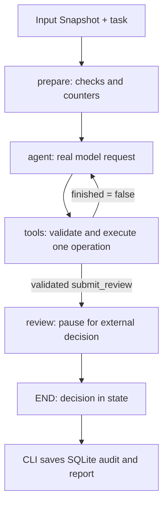

# AccessScope: follow the data, then the agent

Keep this page beside the code. Read one stop, find the named function, and predict its output before continuing. The aim is to rebuild the connections yourself rather than memorize a framework description.

For the local database case, open `private/CASE_STUDY.md` alongside this page. That companion shows the actual redacted snapshot, every policy, all recorded tool arguments/results, and the saved review. It stays outside public Git. The original fixed-graph exercise is in [DEMO_WALKTHROUGH.md](DEMO_WALKTHROUGH.md).

## 1. Understand the job before opening Python

A program runs using an AWS role. The role has policy documents. Somebody needs to review that configuration, know which evidence is missing, and record a decision.

The program is a **workload**, not automatically an AI agent. Our **AI agent** is the investigator reviewing the snapshot. These are different actors.

```text
workload -> role -> policy statements
                         |
                    explicit checks
                         |
             AI investigates and explains
                         |
                  person reviews
                         |
                   decision record
```

AccessScope has one AI investigator, six tool definitions and four registered graph nodes. Several model turns reuse the same investigator. Seven model calls do not mean seven agents.

The database export happens before the CLI run. During investigation, the agent reads an already prepared local snapshot. It does not have database credentials, a SQL tool, or permission to edit AWS.

## 2. Start with the input and its contracts

Open your snapshot, then [models.py](accessscope/models.py). The same source may contain facts of different kinds:

| Input | What it describes | What it does not establish |
| --- | --- | --- |
| Workload-to-role binding | Which role the collected workload uses | Every other consumer of that role |
| Policy document | A configured statement | Whether a particular request will succeed |
| Owner/deadline context | Supplied business information | Accepted ownership unless that is established |
| Coverage flags | What evidence the import declares available | A general certificate that all access is safe |
| Source/export dates | Which point in time the records represent | That AWS still has the same state now |

### Why separate record classes?

`Snapshot` holds input. `Finding` holds one rule outcome. `Brief` holds an explanation. `Decision` holds a review choice. An explanation must not silently replace the facts or a person's decision.

The name `Finding` is broader than it sounds: it stores satisfied and unknown outcomes too. Count `outcome == "finding"` to count active findings.

These are Pydantic contracts: parsing checks fields/types and selected relations. `extra="forbid"` rejects unexpected fields. `Snapshot.unique_references` checks duplicate IDs, account-role scope and the reserved context namespace. It does not prove the source is authentic.

Useful conversions:

| Expression | Produces | Why it appears |
| --- | --- | --- |
| `Snapshot.model_validate_json(text)` | Checked snapshot with parsed dates | Read an input file |
| `record.model_dump(mode="json")` | JSON-compatible dictionary | Put a record into a tool result/report |
| `record.model_dump_json()` | JSON text | Write a complete record |

### If the input came from the database

Open [import_iga.py](accessscope/import_iga.py), `convert`. It accepts a selected export, not a database connection. The one-off export is a separate read-only operation.

The converter checks workspace/chosen-role consistency, pseudonymizes identifiers using a private HMAC salt, redacts sensitive policy values, maps records into `Snapshot`, and writes provenance. The current converter builds a one-role case; it is not a general multi-account importer.

It preserves action names needed by the narrow checker while masking resource/condition strings. Redacted policies are explanation evidence, not deployable IAM documents. Missing owner acceptance or purpose coverage is kept unestablished.

The fingerprint is a hash of the complete serialized snapshot. It binds review to stored contents. It is not a signature, authentication mechanism or live AWS comparison. A changed timestamp also changes it.

**Before continuing:** follow one workload's `role_arn` to its role and one policy's `evidence_id` to its document.

## 3. Watch ordinary code derive the outcomes

Open [rules.py](accessscope/rules.py), `evaluate`.

It builds an ARN-to-role lookup, then performs three checks for each workload. The small inner `emit` helper creates each outcome record. No model runs here.

| Check | Evidence dependency | Main branches |
| --- | --- | --- |
| Accepted production owner | Business context | Incomplete context -> unknown; confirmed non-production -> not applicable; accepted owner -> satisfied; otherwise finding |
| Review deadline | Context and `review_due` | Missing context/date -> unknown; strictly before `as_of` -> finding; otherwise satisfied |
| Exact wildcard-action Allow | IAM and role-policy coverage | Incomplete -> unknown; exact configured pattern -> finding; unsupported shape without that observation -> unknown; otherwise satisfied |

### Action and Resource answer different questions

In IAM, `Action` names operations and `Resource` names the objects they apply to. A resource wildcard is different from an action wildcard. [AWS Action](https://docs.aws.amazon.com/IAM/latest/UserGuide/reference_policies_elements_action.html), [AWS Resource](https://docs.aws.amazon.com/IAM/latest/UserGuide/reference_policies_elements_resource.html).

This fictional fragment has a resource wildcard:

```json
{"Effect": "Allow", "Action": "ec2:DescribeInstances", "Resource": "*"}
```

The current checker searches for exact `Action: "*"` (or a list containing it), not every broad resource scope or service-specific pattern such as `ec2:*`. A satisfied result answers only that implemented question. The checker does not fully validate IAM syntax or compute effective permissions.

### Connect outcomes back to records

`evidence_catalog` maps IDs to policy/context records. `context:<workload-id>` is generated by code; policy IDs come from the snapshot. This is how citations become inspectable sources rather than decorative text.

The context catalog currently labels its source as operator-supplied business context. For an imported case, inspect the provenance: the importer may have supplied explicit unknown placeholders, not independently verified ownership.

`shared_role_consumers` groups selected workloads by role. The live consumer tool also returns a single selected consumer when appropriate. Neither is an AWS-wide dependency inventory.

**Before continuing:** if only IAM coverage fails, explain why an independently complete ownership record need not become unknown. If context coverage fails, explain why that does not prove an owner is absent.

## 4. See what the AI is actually allowed to know and do

Open [agent.py](accessscope/agent.py), first the argument contracts, `ARGUMENTS`, `TOOLS`, and `INSTRUCTIONS`.

A tool has two sides: a description/schema sent to the model, and Python code that executes a validated request. The schema does not itself run a function or grant access.

| Tool | Model supplies | Executor provides |
| --- | --- | --- |
| `get_review_findings` | Empty arguments | This case's date, coverage, workload bindings and all rule outcomes |
| `get_evidence` | Exact `evidence_id` | One source from the selected catalog |
| `get_role_evidence` | Selected `role_arn` | Its collected policies in one bounded lookup |
| `get_shared_consumers` | Selected `role_arn` | Known selected workload IDs, with a scope limitation |
| `search_aws_docs` | One allowed topic | Tavily sources from AWS documentation |
| `submit_review` | `Brief` plus web-source IDs | Acceptance only if the completion checks pass |

The prompt requests a sensible investigation. The executor independently checks capability names, arguments, role/evidence scope and budgets. A model proposing another tool name does not create that capability.

### What is the AI's job if the rules already ran?

The AI chooses which context/policies to inspect next, connects shared impact, researches general guidance and synthesizes useful reviewer questions. It does not invent the deterministic outcomes, authenticate a reviewer or decide what AWS authorizes.

This is a defensible role, but it is still a hypothesis about usefulness. Compare its output with a template baseline before claiming it saves review time or improves accuracy. The fact that a model call happened is not proof of value.

## 5. Understand the state before reading the loop

`AgentState` extends the common state in [workflow.py](accessscope/workflow.py).

| Field | Why the next operation needs it |
| --- | --- |
| `snapshot`, `fingerprint`, `findings` | Evidence, version binding and deterministic outcomes |
| `task` | User's investigation request |
| `conversation` | Previous model requests and tool results |
| `pending_calls` | The one proposed operation waiting for execution |
| `seen_evidence` | IDs whose records were successfully returned |
| `tool_log` | Inspectable history of attempted operations/results |
| `research_sources`, `cited_source_ids` | Returned public guidance and the sources used |
| `finished`, `brief` | Whether a structured submission passed the gate |
| `model_calls`, `usage` | Logical call budget and returned token totals |
| `decision` | External review input after the pause |

`TypedDict` names working fields; it is not another database or Pydantic parser. `total=False` allows fields to appear as execution progresses. No custom reducers are defined. A returned field replaces that field's value; omitted fields remain.

That is why conversation updates explicitly use `old_conversation + new_items`. Lists do not automatically append themselves.

## 6. Follow one model request and one tool response

Inside `build_agent_graph`, read `prepare`, `agent`, and `tools` in that order.

`prepare` parses the snapshot, computes the fingerprint and outcomes, and initializes empty histories/counters. The data is in graph state, but it has not automatically become model input.

The first `agent` call sends the task, instructions and tool definitions. Its `input` is the selected `conversation`, not the entire `state` dictionary. Snapshot information reaches the model when tools return it. Tracing is a separate destination and may record node state.

The model responds with a function-call item. Its `arguments` field is JSON text. The executor uses the named argument contract's `model_validate_json` to parse it, then runs an allowed branch. It does not evaluate arbitrary generated Python.

The result is returned in this protocol shape; the IDs below are schematic:

```json
{"type": "function_call_output", "call_id": "provider-call-id", "output": "JSON result text"}
```

`call_id` connects our result to the model's requested operation. The next model request includes the previous function call and this matching result. SDK outputs are converted to primitive JSON before entering checkpoint state.

The `tool_log` report stores operation arguments/results, not every raw provider response. Use the trace for provider-call details; do not expect every call ID in `review.json`.

### What causes the loop to continue?



The conditional edge is ordinary code:

```python
builder.add_conditional_edges(
    "tools", lambda s: "review" if s["finished"] else "agent"
)
```

The model influences which tool it proposes. The application controls execution and the route to review. A sentence saying "I'm done" cannot set `finished=True`.

`StateGraph(AgentState)` is the builder. `add_node` registers functions without calling them. Edges describe transitions. `compile` returns the executable object; `stream`/`invoke` later run it with input.

## 7. Understand completion and human review

Read the `submit_review` branch and the shared `validate_brief` function.

The code checks shape, nonempty summary, known IDs, coverage of active findings, read-before-cite, at least some context/policy inspection when available, and returned web-source IDs. `seen_evidence` records successful retrieval, not proof that the model understood a record.

The current policy-inspection gate recognizes IDs starting with `policy:`; the importer follows that convention. A general importer accepting arbitrary evidence-ID formats should derive the policy-ID set from typed records instead of relying on that prefix. The existence/citation checks still use the selected catalog.

With no active findings, the required active-ID set is empty. Unknown/satisfied outcomes may still be cited. A brief naming six outcome IDs does not thereby identify six security failures.

Some instructions are prompt guidance rather than enforced properties: the 220-word preference, a request to research, and semantic faithfulness. The executor enforces research attempt limits and source-ID membership, but does not require a nonempty source list for every submission. Know which guarantees come from code.

`review` calls `interrupt`. A checkpointer retains state and `thread_id` identifies it. On resumption, the interrupted node restarts and `interrupt()` returns the supplied decision. Model work sits earlier, so ordinary review resumption does not repeat it. [LangGraph interrupts](https://docs.langchain.com/oss/python/langgraph/interrupts).

The decision fingerprint must match stored evidence. It does not authenticate the reviewer or re-read current AWS state. `retain`, `investigate` and `propose_change` record review intent; none executes a permission change.

## 8. Connect the CLI, files and identities

Now read [cli.py](accessscope/cli.py) from `main`, alongside [settings.py](accessscope/settings.py).

```text
parse arguments -> load live settings -> select input
  -> save snapshot -> construct graph -> stream until pause
  -> save investigation -> obtain choice -> resume same thread
  -> record audit -> save report -> verify trace delivery
```

The normal default is a private snapshot plus the real agent. `--demo` selects the old scripted lesson explicitly. Missing live input/credentials does not silently select dummy output.

| File | Role and lifetime |
| --- | --- |
| `snapshot.json` | Input used for this run |
| `investigation.json` | Tool history, sources, usage and brief; saved before the human prompt |
| `review.json` | Completed case including outcomes and decision |
| `reviews.db` | Persistent completed-decision rows |
| In-memory checkpointer | Unfinished graph state, lost on process restart |

The default directory is `outputs/latest`; new runs overwrite its JSON exports. SQLite retains case rows, but does not archive every historical snapshot/brief for you. A complete audit archive would need immutable per-case artifacts as well.

`case_id` names the review. This CLI also uses it as `thread_id`. The snapshot fingerprint names exact input contents. A trace run ID names a tracing span, not evidence or reviewer authority. Resuming review creates another trace root while retaining the graph thread.

`record_decision` uses `(case_id, fingerprint)` as its SQLite key and compares the stored decision payload. Exact retries retain one row; conflicting payloads are rejected. Fresh default CLI invocations get fresh case IDs, so they are separate reviews.

### Configuration and data destinations

Local `.env` is loaded for live operation, with exports taking precedence. `OPENAI_MODEL` overrides `CHAT_MODEL`. Local project tracing uses `LANGSMITH_PROJECT`; legacy agent-address labels are moved to metadata to avoid conflicting destinations.

OpenAI receives the model conversation. Tavily receives fixed public documentation queries, not private account strings. LangSmith can receive selected evidence, node/tool results and model inputs/outputs. Local state and exported reports do not contain API keys. Use authorized evidence for those destinations.

## 9. Know the limits and how they fail

| Limit/check | Implemented behavior |
| --- | --- |
| Model turns | At most ten; reaching the ceiling before accepted submission stops execution |
| Tool calls per turn | Exactly one required; parallel tool calls are disabled |
| Research | At most two attempts, including failed attempts |
| Model request | 30-second client timeout; no automatic SDK retries; 1,600 output-token cap |
| Conversation | 60,000 serialized-character guard before a request |
| Tool result | 16,000 serialized-character guard; an oversized result is rejected |
| Bad tool arguments/scope | Bounded error returned to the model; attempt stays in the log |
| Provider failure | Run can stop before a completed review; no cloud action follows |

Character budgets are not exact token/cost budgets. Token usage is summed from responses and includes history sent repeatedly. Trace spans are observations, not additional model generations.

The original checks are in [test_review.py](tests/test_review.py); real-loop boundary checks are in [test_agent.py](tests/test_agent.py). Unit tests block network and use fake providers. Saved live reports establish what happened on particular real runs, not an accuracy percentage.

Read an existing report without starting another paid run:

```bash
uv run python -c 'import json; from pathlib import Path; r=json.loads(Path("outputs/live-authsec-final/review.json").read_text()); print(r["mode"], r["model_calls"]); print([x["name"] for x in r["tool_log"]])'
```

That local path exists after the recorded case run; a fresh clone has no private input or saved reports. To start a new authorized live review, use `uv run python -m accessscope.cli` from the project folder.

## 10. Improve one demonstrated weakness at a time

| Next step | Why it comes next | Concrete acceptance check |
| --- | --- | --- |
| Labelled semantic evaluation | Known IDs can accompany false prose | Cases catch invented owners, effective-access claims and consumer-scope overclaims; compare with a template baseline |
| More authoritative context | Current context may be unknown rather than missing in reality | Owner acceptance/deadline evidence has provenance and field-specific coverage |
| Immutable case artifacts | `outputs/latest` overwrites historical JSON | An old audit row can recover its exact input, brief, rule/prompt/model versions and decision |
| Durable checkpoints and authenticated review | Current unfinished state and reviewer identity are local | A permitted reviewer can resume after restart; another workspace cannot read/resume the case |
| Freshness and direct AWS integration | Current database evidence represents an earlier scan | Same contract from a scoped live read; failure remains partial; old evidence is not silently current |
| Measured optimization | More agents may add cost without value | Compare quality, useful questions, tokens, latency and duplicate work on the same cases |

For direct input collection, read [collect.py](accessscope/collect.py). It is an input adapter, not an agent permission-write tool. For a larger importer, define stable account-level pseudonyms, multiple roles and explicit scope/coverage before expanding the current one-role case.

A future agent identity integration would authenticate the caller and enforce scopes at server-side tool boundaries. Current in-memory ID membership checks are not an AuthSec OIDC/SPIFFE integration. A future remediation executor would additionally need fresh-state checks and specifically authorized operations; it does not belong in an unrestricted model tool.

Your closed-book explanation should follow the data: input -> repeatable outcomes -> selected evidence -> model/tool loop -> validated submission -> external review -> stored decision. Then change one input and explain what changes. That is the skill the architecture discussion should reveal.
